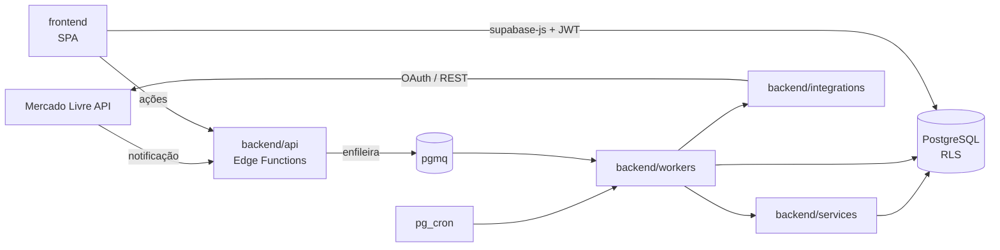

# Arquitetura

## Visão geral

Monólito modular em TypeScript sobre Supabase. O banco PostgreSQL é a fonte da verdade e também hospeda a fila e os agendamentos; o código de servidor roda em Edge Functions; o painel é uma SPA estática. Não há servidor sempre ligado.



## Estrutura do repositório

```
frontend/
  src/
    app/            rotas e layout
    features/       telas por domínio (pedidos, financeiro, fornecedores…)
    lib/            cliente Supabase, formatação, utilitários de UI
backend/
  api/              handlers HTTP das Edge Functions
  workers/          consumidores de fila e jobs agendados
  services/         regras de negócio puras, por domínio
  integrations/
    mercadolivre/   cliente HTTP, OAuth, mapeamento de payloads
    suppliers/      adaptadores de fornecedores
    supabase/       chamadas RPC ao banco com a chave de serviço
    telegram/       envio de alertas
  shared/           tipos, erros, logger, configuração
supabase/
  config.jsonc
  migrations/       schema, RLS, funções SQL, extensões
  functions/        entrypoints de deploy; cada um apenas importa backend/api
  tests/            testes de banco (pgTAP)
monitoring/         verificações de saúde e regras de alerta
tests/e2e/          fluxos completos com usuários de teste
docs/
  adr/              decisões de arquitetura
  integrations/     capacidades de APIs externas confirmadas
.github/workflows/  CI
```

A pasta `supabase/` concentra banco e deploy porque a CLI do Supabase exige `supabase/config.jsonc`, `supabase/migrations/` e `supabase/functions/` nesse local. A lógica de servidor fica em `backend/`; os entrypoints em `supabase/functions/` não contêm regra.

## Dependências entre camadas

| Camada | Pode depender de | Não pode depender de |
|---|---|---|
| `backend/services` | `backend/shared` | runtime Deno, HTTP, SDKs, banco |
| `backend/integrations` | `backend/shared` | `services`, `api`, `workers` |
| `backend/workers` | `services`, `integrations`, `shared` | `api` |
| `backend/api` | `services`, `shared` | `integrations` diretamente para escrita externa |
| `frontend` | Supabase (leitura com RLS), `backend/api` | chave `service_role`, `backend/*` |

Escritas em sistemas externos passam por workers e pelo orquestrador de ações, nunca diretamente por uma rota HTTP.

O backend acessa o banco apenas por funções RPC `security definer` no schema `public`, executáveis somente por `service_role`. Tabelas operacionais ficam em `ops` e `private`, fora da Data API. Tokens de marketplace ficam no Supabase Vault e só são lidos por `read_marketplace_tokens`.

## Fluxos principais

1. **Notificação do Mercado Livre:** `api/ml-notifications` valida origem (IPs publicados), aplicação e formato, grava o evento em `ops.integration_events` com deduplicação de pendentes por `(topic, resource)` e enfileira em `pgmq`; responde 200. O worker consulta o recurso com token, compara com o último estado, persiste e emite eventos de domínio. Detalhes no ADR 0003.
2. **Reconciliação:** job agendado consulta `/orders/search` e `/missed_feeds` para recuperar eventos perdidos.
3. **Pedido:** estado interno segue a máquina de `docs/domain-model.md`; etiqueta liberada é gerada via `/shipment_labels` e associada ao pedido de compra do fornecedor.
4. **Financeiro:** custo, tarifa e frete são registrados como snapshot no pedido; a conciliação compara com valores cobrados. ADR 0004.
5. **Ações:** recomendações geram propostas; execução só por aprovação, com limite, idempotência e auditoria.

## Decisões

| ADR | Tema |
|---|---|
| [0001](adr/0001-plataforma.md) | Plataforma: Supabase, Edge Functions e TypeScript |
| [0002](adr/0002-frontend.md) | Frontend: SPA estática no Cloudflare Pages |
| [0003](adr/0003-notificacoes-e-filas.md) | Notificações, fila e reconciliação |
| [0004](adr/0004-calculo-financeiro.md) | Dinheiro, snapshots e conciliação |
| [0005](adr/0005-identidade-e-acesso.md) | Autenticação, MFA, RBAC e RLS |
| [0006](adr/0006-segredos-e-tokens.md) | Segredos e tokens OAuth |
| [0007](adr/0007-observabilidade.md) | Logs, auditoria, saúde e alertas |
