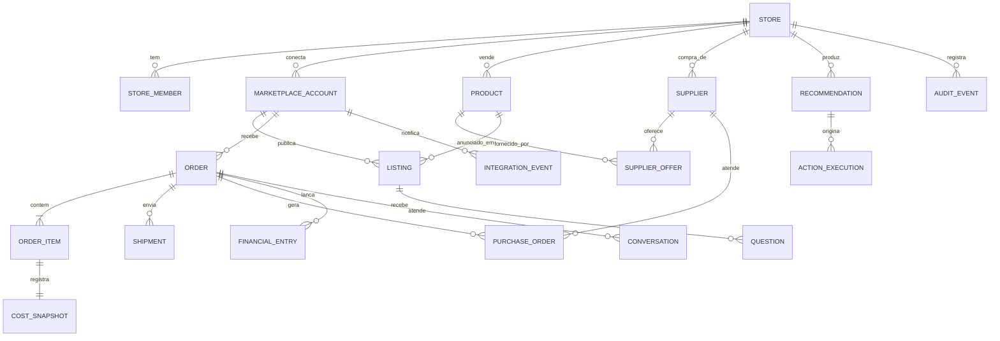
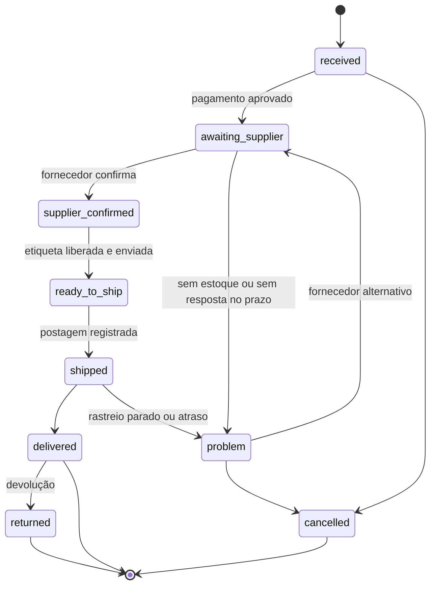

# Modelo de domínio

## Entidades

| Entidade | Dados essenciais |
|---|---|
| `store` | Nome, documento fiscal (opcional), regime, status |
| `store_member` | Usuário, papel (`owner`, `operator`, `finance`, `viewer`) |
| `marketplace_account` | Canal, `seller_id`, tokens criptografados, expiração, status de autorização |
| `product` | SKU, título, categoria, atributos, peso e dimensões |
| `supplier` / `supplier_offer` | SLA de despacho, canal de pedido, custo, estoque informado, vigência |
| `listing` | ID externo, produto, preço, tipo de anúncio, logística, status |
| `order` / `order_item` | ID externo, `pack_id`, estado interno, estado externo, datas, quantidades, preço |
| `cost_snapshot` | Custo, tarifa estimada, frete, impostos, versão de parâmetros, data |
| `shipment` | ID externo, logística, prazo de despacho, status, etiqueta |
| `purchase_order` | Fornecedor, itens, status, confirmação, rastreio |
| `financial_entry` | Tipo, valor, moeda, competência, origem, estimado ou realizado |
| `conversation` / `question` | ID externo, intenção classificada, prazo de resposta, status |
| `recommendation` | Hipótese, evidências, período, impacto, risco, confiança, validade |
| `action_execution` | Ação, payload, chave de idempotência, aprovador, resultado, compensação |
| `integration_event` | Tópico, recurso, recebimento, tentativas, status de processamento |
| `audit_event` | Ator, ação, entidade, antes/depois, `correlation_id`, hash encadeado |

Toda entidade de negócio tem `store_id`, `created_at` e `updated_at` em UTC.

## Estado do pedido

O estado interno é derivado do estado do Mercado Livre e dos eventos de fornecedor; transições fora do diagrama são rejeitadas e registradas.

## Eventos de domínio

`order.synced`, `order.state_changed`, `shipment.label_available`, `purchase_order.created`, `purchase_order.confirmed`, `cost.snapshot_recorded`, `deadline.at_risk`, `question.received`, `conversation.awaiting_reply`, `recommendation.created`, `action.approved`, `action.executed`, `action.compensated`.

## Invariantes

1. Dinheiro em `numeric(14,2)` com moeda; nenhum cálculo monetário em ponto flutuante.
2. Todo `order_item` com margem calculada possui `cost_snapshot`; sem custo essencial, a margem é `unknown`.
3. Um recurso externo (`marketplace_account_id`, tipo, ID externo) corresponde a um único registro.
4. Atualização de pedido só é aplicada se o `last_updated` externo for mais recente que o salvo.
5. `action_execution` com mesma chave de idempotência não executa duas vezes.
6. `audit_event` não admite UPDATE nem DELETE; cada registro referencia o hash do anterior.
7. Ação de alto impacto exige aprovação de identidade diferente da que propôs, antes da expiração.
